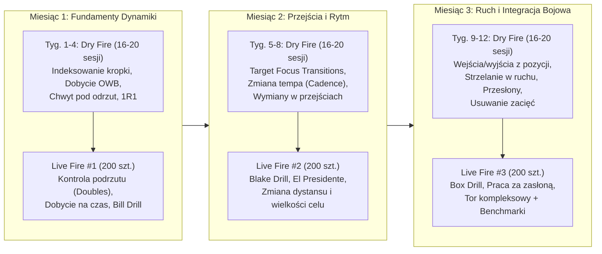

# 01. Plan Cyklu 12 Tygodni (Makrocykl 3-Miesięczny)

Plan zakłada strukturę **3 mezocykli po 4 tygodnie**. W każdym miesiącu przez 3,5 tygodnia budujesz i przyspieszasz automatyzmy w domu (**16–20 jednostek Dry Fire**), a w ostatnim tygodniu miesiąca weryfikujesz je na strzelnicy (**1 jednostka Live Fire – 200 szt. amunicji**).

---

## 🗓️ MIESIĄC 1: Indeksowanie Kropki, Dobycie i Kontrola Odrzutu
**Cel główny:** Sprawić, aby po każdym dobyciu z kabury OWB oraz po każdym przeładowaniu kropka kolimatora pojawiała się natychmiast w centrum celu bez jej „szukania”, a chwyt gwarantował powrót kropki w to samo miejsce podczas strzelania dubletów.

| Tydzień | Fokus w Dry Fire (4–5x / tydz.) | Cel mierzalny (Par Time / Jakość) |
| :--- | :--- | :--- |
| **Tydzień 1** | **Mechanika dobycia na 4 tempa i indeksowanie kropki.** Budowanie powtarzalnego chwytu jeszcze na kaburze i przy klatce piersiowej (z zamkniętymi oczami kropka musi być w oknie po ich otwarciu). | 10/10 dobyć z zamkniętymi oczami kończy się kropką w środkowej 1/3 okna kolimatora. |
| **Tydzień 2** | **Szybkość dobycia do pierwszego strzału (Surrender & Hands at Sides) + Pre-prep spustu.** Wybieranie jałowego ruchu spustu jeszcze w trakcie wypychania broni w kierunku celu. | Dobycie OWB do A-zone (7 m symulowane): zejście z **1.50 s do 1.20 s**. |
| **Tydzień 3** | **Awaryjna wymiana magazynka (Slide-lock / 1R1) + Praca jedną ręką (SHO/WHO).** Utrzymanie broni wysoko w przestrzeni roboczej (workspace) i wbicie wzroku w fazkę gniazda magazynka. | Wymiana magazynka od strzału do strzału (w Dry Fire do kliku/obrazu kropki): **< 1.50 s**. |
| **Tydzień 4** | **Symulacja ciągów strzałów (Bill Drill na sucho) + Przygotowanie do Live Fire #1.** Utrzymanie miażdżącego chwytu ręki wspomagającej przez 6 „strzałów” z rzędu bez drgnięcia kropki. | **Sesja Live Fire #1** (Karta Treningowa #1): Walidacja dubletów, *Bill Drill* < 2.50 s (100% Alfa z 7 m). |

---

## 🗓️ MIESIĄC 2: Przejścia Między Celami (Transitions) i Zmiana Rytmu (Cadence)
**Cel główny:** Przestać tracić czas między tarczami. Na poziomie średniozaawansowanym strzelcy strzelają szybko na jednej tarczy (split 0.20 s), ale przejście na sąsiednią tarczę zajmuje im 0.60–0.80 s przez „ciągnięcie wzroku za bronią”. W tym miesiącu uczysz się prowadzić broń oczami (*Eye-Led Transitions*) oraz dostosowywać potwierdzenie kropki do trudności celu.

| Tydzień | Fokus w Dry Fire (4–5x / tydz.) | Cel mierzalny (Par Time / Jakość) |
| :--- | :--- | :--- |
| **Tydzień 5** | **Mechanika przejść wzrokowych (Snap Eyes).** 3 tarcze blisko siebie (Blake Drill). Oczy przeskakują na środek kolejnej strefy Alfa w momencie padania drugiego strzału na poprzedniej tarczy. | Przejście między tarczami oddalonymi o 1 m (z 7 m) poniżej **0.30–0.35 s** bez przestrzelenia krawędzi tarczy (over-swing). |
| **Tydzień 6** | **Szerokie przejścia (90–180 stopni) + Obroty (El Presidente).** Praca biodrami i kolanami przy szerokich przeniesieniach, składanie broni bliżej ciała przy obrocie o 180°. | *El Presidente* w Dry Fire (obrót + 2x3 + wymiana + 2x3) w Par Time **< 5.50 s**. |
| **Tydzień 7** | **Zmiana tempa i potwierdzenia celowania (Confirmation Levels 1–2–3).** Łączenie dużych celów (bliska Alfa – strzał z rozmazanej kropki w ruchu) z małymi celami (Headbox / zakładnik – pełne zatrzymanie kropki). | *Mozambik (2 w korpus + 1 w głowę)* z dobycia w Par Time **< 2.00 s**. |
| **Tydzień 8** | **Wymiana magazynka w trakcie przejścia między celami.** Kończysz tarczę T1, zaczynasz wymianę magazynka i przenosisz wzrok na T2 – gdy magazynek wchodzi w gniazdo, broń jest już wycelowana w T2. | **Sesja Live Fire #2** (Karta Treningowa #2): Walidacja *Blake Drill*, *El Presidente* oraz *Failure Drill*. |

---

## 🗓️ MIESIĄC 3: Ruch, Przesłony i Integracja Bojowa / Praktyczna
**Cel główny:** Połączenie szybkiego strzelania z poruszaniem się. Nauka dynamicznego wyjścia ze stanowiska, agresywnego hamowania z gotową bronią w celu (zanim druga stopa dotknie ziemi, kropka jest już na tarczy), strzelania w marszu oraz pracy zza zasłon (wychylenia boczne, pozycja klęcząca).

| Tydzień | Fokus w Dry Fire (4–5x / tydz.) | Cel mierzalny (Par Time / Jakość) |
| :--- | :--- | :--- |
| **Tydzień 9** | **Wejścia i wyjścia ze stanowiska (Position Entry & Exit).** Zasada: odrywasz broń od celu dopiero gdy rusza biodro; przy wejściu w pozycję celujesz na ostatnim kroku hamującym. | Przemieszczenie o 2–3 kroki w bok od strzału do pierwszego strzału w nowej pozycji w **< 1.80 s**. |
| **Tydzień 10** | **Strzelanie w ruchu ciągłym (przód/tył/skos) z MantisX.** Obniżenie środka ciężkości (amortyzacja w kolanach i biodrach), przetaczanie stopy pięta–palce przy ruchu do przodu i palce–pięta do tyłu. | Utrzymanie drgań kropki kolimatora wyłącznie wewnątrz strefy Alfa podczas ciągłego marszu. |
| **Tydzień 11** | **Praca na przesłonie (Barricade / Cover) i wymuszone pozycje.** Szybkie zejście na kolano, wychylenia z prawej i lewej strony przesłony bez wystawiania stóp i łokci („krojenie tortu” / slicing the pie). | Dobycie ze zejściem na kolano i oddaniem strzału zza zasłony w **< 1.80 s**. |
| **Tydzień 12** | **Usuwanie zacięć (Tap-Rack & Double Feed) + Test Końcowy.** Błyskawiczna diagnostyka (brak strzału -> uderz/przeładuj) oraz integracja wszystkich elementów przed wyjazdem na oś. | **Sesja Live Fire #3** (Karta Treningowa #3): *Box Drill*, praca za zasłoną i pełny test benchmarków po 12 tygodniach. |

---

## 🔄 Co po 12 tygodniach?
Po ukończeniu 12. tygodnia i zapisaniu wyników w [05-dziennik-postepow.md](./05-dziennik-postepow.md):
1. Porównujesz swoje wyniki *Cold Start* z Miesiąca 1 i Miesiąca 3.
2. Obniżasz docelowe czasy Par Time o **10–15%** (lub zwiększasz dystans na strzelnicy z 7 m na 10–12 m).
3. Rozpoczynasz kolejny cykl, kładąc nacisk na najsłabszy element wykazany na kartach Live Fire.
