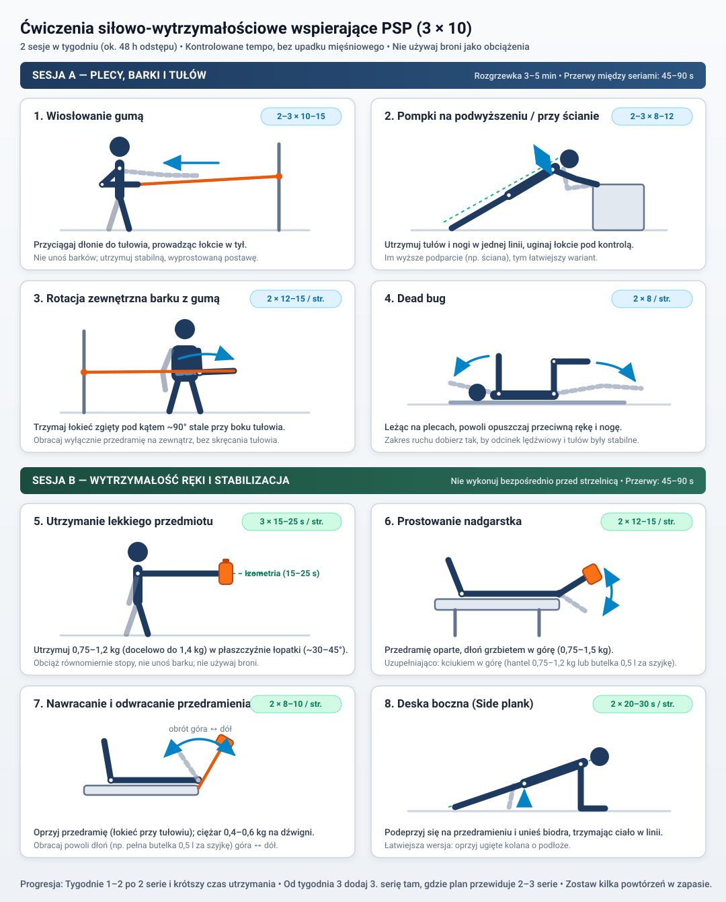

# Ćwiczenia siłowo-wytrzymałościowe wspierające PSP

**Aktualizacja:** 2026-11-18  
**Cel:** ogólna wytrzymałość obręczy barkowej, przedramion i tułowia przy treningu pistoletowym jednorącz.  
**Punkt odniesienia sprzętowego:** Benelli MP 95E (.22 LR) — masa ok. 1,10–1,12 kg, środek ciężkości przesunięty w stronę lufy.  
**Częstotliwość:** 2 sesje tygodniowo, uzupełniające cykl [PSP 3 × 10](./README.md).

Ćwiczenia mają wspierać trening strzelecki, a nie zastępować nauki techniki. Stosuj obciążenie pozwalające zachować swobodny, kontrolowany ruch. Nie ćwicz do upadku mięśniowego i nie używaj broni jako obciążenia.

## Plan tygodnia

| Sesja | Ćwiczenia | Przerwy |
|---|---|---|
| **A — plecy, barki, tułów** | Wiosłowanie gumą, pompki przy ścianie lub na podwyższeniu, rotacja zewnętrzna barku z gumą, dead bug. | Odpocznij 45–90 s między seriami. |
| **B — wytrzymałość ręki i stabilizacja** | Utrzymanie lekkiego przedmiotu na wyprostowanej ręce, prostowanie nadgarstka, nawracanie i odwracanie przedramienia, deska boczna. | Odpocznij 45–90 s między seriami. |

Rozłóż sesje w tygodniu, najlepiej w odstępie około 48 godzin. Jeśli łączysz ćwiczenia z treningiem bezstrzałowym, najpierw wykonaj trening strzelecki. Unikaj męczącej sesji ręki i barku bezpośrednio przed treningiem na strzelnicy.

## Sesja A — plecy, barki i tułów

Po 3–5 minutach lekkiej rozgrzewki:

1. **Wiosłowanie gumą — 2–3 × 10–15.** Zamocuj gumę do stabilnego punktu. Przyciągaj dłonie w kierunku tułowia, prowadząc łokcie do tyłu. Nie unoś barków.
2. **Pompki przy ścianie lub na podwyższeniu — 2–3 × 8–12.** Ustaw dłonie na stabilnej powierzchni. Utrzymuj tułów w jednej linii, uginaj łokcie i wracaj do pozycji początkowej w kontrolowanym tempie. Im wyższe podparcie, tym łatwiejsze ćwiczenie.
3. **Rotacja zewnętrzna barku z lekką gumą — 2 × 12–15 na stronę.** Trzymaj łokieć przy boku, zgięty mniej więcej pod kątem prostym. Obracaj przedramię na zewnątrz bez odrywania łokcia od tułowia i bez skręcania całego ciała. Guma musi być bezpiecznie zamocowana.
4. **Dead bug — 2 × 8 na stronę.** Leżąc na plecach, naprzemiennie opuszczaj przeciwną rękę i nogę w zakresie, który pozwala utrzymać stabilny tułów. Wróć do pozycji początkowej i zmień stronę.

## Sesja B — wytrzymałość ręki i stabilizacja

1. **Utrzymanie lekkiego przedmiotu na wyprostowanej ręce — 3 × 15–25 s na stronę.** Stań stabilnie, równomiernie obciążając obie stopy, i unieś rękę do wygodnej wysokości w płaszczyźnie łopatki (ok. 30–45° skośnie w przód, jak w naturalnej postawie strzeleckiej), nie unosząc barku. Użyj butelki z wodą lub hantelki o masie **0,75–1,0 kg** na start, przechodząc do **1,1–1,2 kg** (masa Benelli MP 95E), a docelowo maksymalnie **1,25–1,4 kg**; nie używaj broni. Opuść rękę, zanim pojawi się ból albo wyraźna utrata kontroli.
2. **Prostowanie nadgarstka — 2 × 12–15 na stronę.** Oprzyj przedramię na udzie lub stole, pozostawiając dłoń poza krawędzią, grzbietem dłoni do góry. Unieś dłoń w nadgarstku, a następnie opuść ją powoli. Zacznij od obciążenia **0,75–1,0 kg** (docelowo **1,25–1,5 kg**). Ze względu na wyważenie Benelli MP 95E na lufę uzupełniająco wykonaj 1–2 serie w ustawieniu dłoni kciukiem do góry (odwodzenie promieniowe: hantel **0,75–1,2 kg** lub butelka **0,5 l / ok. 0,5 kg** trzymana poziomo za szyjkę).
3. **Nawracanie i odwracanie przedramienia — 2 × 8–10 na stronę.** Oprzyj przedramię, łokieć trzymaj blisko tułowia. Chwyć przedmiot o masie **0,4–0,6 kg** z przesuniętym środkiem ciężkości (np. pełną butelkę 0,5 l za szyjkę lub młotek 400–500 g w 2/3 długości trzonka) i powoli obracaj dłoń raz wnętrzem w górę, raz w dół. Ruch wykonuj w wygodnym, kontrolowanym zakresie.
4. **Deska boczna — 2 × 20–30 s na stronę.** Podeprzyj się na przedramieniu i unieś biodra, utrzymując tułów w jednej linii. Łatwiejsza wersja: oprzyj kolana o podłoże.

## Schematy ruchów

Rysunki są uproszczonymi schematami pozycji i kierunku ruchu. Szczegółowy opis wykonania znajduje się wyżej.

## Progresja i dopasowanie obciążenia

- **Tygodnie 1–2:** wykonuj po 2 serie każdego ćwiczenia; w utrzymaniu ręki zacznij od krótszego czasu.
- **Od tygodnia 3:** jeśli ćwiczenia są komfortowe i technika pozostaje stabilna, dodaj trzecią serię tam, gdzie plan przewiduje 2–3 serie.
- Najpierw zwiększaj liczbę powtórzeń lub czas utrzymania w podanym zakresie. Dopiero później rozważ niewielkie zwiększenie obciążenia.
- Zostaw kilka powtórzeń „w zapasie”; nie doprowadzaj do drżenia ani utraty kontroli przed treningiem strzeleckim.
- Zmniejsz obciążenie lub przerwij ćwiczenie przy bólu, drętwieniu albo pogorszeniu zakresu ruchu. Przy wcześniejszych urazach barku, łokcia lub nadgarstka skonsultuj dobór ćwiczeń z fizjoterapeutą lub lekarzem.

### Wytrzymałość ogólna

Opcjonalnie dodaj 1–2 spokojne marsze lub jazdy na rowerze tygodniowo po 20–30 minut, w tempie pozwalającym swobodnie rozmawiać. Potraktuj je jako ogólną aktywność uzupełniającą, nie trening strzelecki.
