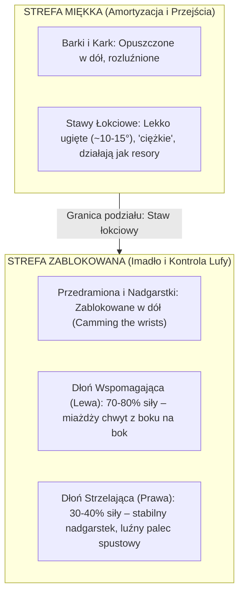

# Biomechanika Chwytu: Izolacja Blokady Nadgarstków od Rozluźnienia Ramion i Barków

W dynamicznym strzelaniu wielostrzałowym (*Doubles*, *Bill Drill*, *Blake Drill*) z pistoletu wyposażonego w kolimator (**Glock + Red Dot**) kluczowym fundamentem kontroli odrzutu jest pozornie sprzeczne połączenie dwóch stanów napięcia mięśniowego: **całkowicie zablokowanych nadgarstków i przedramion** oraz **rozluźnionych łokci i obręczy barkowej**.

---

## ⚙️ 1. Dlaczego tak to działa? (Mechanika Wielostrzałów)

Podczas strzelania szybkich serii (splity **0.17–0.22 s**) układ ruchu musi jednocześnie:
1. **Zablokować zawias najbliżej osi lufy (Nadgarstki):** Jeśli nadgarstki „złamią się” w podrzucie, pistolet zadziera wysoko, a kropka kolimatora ucieka ponad górną krawędź okna.
2. **Zamortyzować pęd zamka (Łokcie i Barki):** Gdy zablokujesz łokcie „na sztywno” i podciągniesz barki pod uszy (tzw. pozycja „żółwia”), cała energia odrzutu przechodzi przez sztywne ręce prosto w tułów. Pistolet zaczyna wtedy skakać góra–dół, a przy powrocie zamka lufa nurkuje poniżej celu (*dipping*). Lekko ugięte, elastyczne łokcie i opuszczone barki działają jak **amortyzatory samochodowe** – pochłaniają energię odrzutu, a zablokowane nadgarstki sprawiają, że kropka wraca dokładnie w ten sam punkt strefy Alfa (*return to zero*).
3. **Umożliwić błyskawiczne przejścia między celami (*Target Transitions*):** Spięta obręcz barkowa działa jak hamulec przy przenoszeniu broni z tarczy T1 na T2, powodując szarpany ruch i efekt przestrzeliwania za tarczę (*overswing*).

---

## 🧭 2. Zasada „Strefy Podziału na Łokciu” i Asymetria 70/30

Naturalnym odruchem układu nerwowego na komendę *„trzymaj mocno broń”* jest spięcie całej górnej połowy ciała (tzw. irradiacja napięcia). Aby temu zapobiec, podziel ręce na dwie niezależne strefy, których granicą jest **staw łokciowy**:

* **Uwaga na prawą dłoń:** Prawy nadgarstek jest usztywniony (nie łamie się w górę), ale **palce prawej dłoni nie mogą być zaciśnięte na 100%**. Kurczowe ściśnięcie całej prawej pięści zamrozi palec wskazujący (*trigger freeze*) lub ściągnie szybkie dublety w lewo-dół (*sympathetic squeeze*).

---

## 🏠 3. Protokół 4 Ćwiczeń Izolacyjnych w Dry Fire (3–4 minuty)

Wplataj poniższe mikro-ćwiczenia w rozgrzewkę przed **Jednostką A** lub **Jednostką B** programu Dry Fire.

### Ćwiczenie 1: „Wdech–Zacisk / Wydech–Zrzut Barków” (Kalibracja statyczna)
* **Cel:** Nauczyć układ nerwowy rozdzielania zacisku przedramion od napięcia mięśni czworobocznych (kapturowych) i naramiennych.
* **Wykonanie:**
  1. Wyprowadź rozładowaną broń w mały punkt na ścianie.
  2. Zbuduj **100% docisku dłoni wspomagającej** i zablokuj nadgarstki. Jednocześnie **celowo i przesadnie podciągnij barki pod uszy oraz zablokuj łokcie na prosto**. Obserwuj w oknie kolimatora drobne, szybkie drżenie kropki wywołane napięciem barków.
  3. Zrób powolny wydech i **„upuść” barki o 2–3 cm w dół**, a łokcie odblokuj o 10–15° (niech staną się „ciężkie”), **nie odpuszczając ani grama siły w małym i serdecznym palcu lewej dłoni**.
* **Kryterium sukcesu:** Drżenie kropki kolimatora natychmiast ustaje – plamka „zamarza” w centrum celu, podczas gdy mięśnie przedramion nadal intensywnie pracują.

### Ćwiczenie 2: „Drybling Kropką” (Mikro-pompowanie w łokciach)
* **Cel:** Sprawdzenie, czy blokada nadgarstków jest niezależna od kąta ugięcia łokci.
* **Wykonanie:**
  1. Wyceluj w tarczę z pełnym chwytem i zablokowanymi nadgarstkami.
  2. Nie zmieniając kąta w nadgarstkach, wykonaj 5 małych, płynnych ugięć i wyprostów w samych łokciach i barkach (przybliżając i oddalając pistolet o 2–3 cm w osi wzrok–cel).
* **Kryterium sukcesu:** Pistolet porusza się lekko przód–tył jak na szynach, a **kropka kolimatora ani na moment nie ucieka w górę ani w dół okna**. Jeśli przy ugięciu łokci kropka wędruje po szybce, oznacza to, że Twoje nadgarstki są luźne, a broń trzymasz siłą bicepsów i barków.

### Ćwiczenie 3: „Test Buhaja vs Test Sprężyny” (Weryfikacja na przejściach)
* **Cel:** Wyeliminowanie spięcia obręczy barkowej podczas przenoszenia broni między tarczami (*Blake Drill*).
* **Wykonanie:**
  1. Stań przed 2–3 tarczami redukcyjnymi. Zablokuj nadgarstki i ściśnij chwyt dłonią wspomagającą.
  2. Przenieś wzrok na sąsiednią tarczę i dociągnij za nim broń.
* **Diagnostyka:**
  * **Objaw spiętych barków („Buhaj”):** Ruch jest kanciasty, broń przelatuje za strefę Alfa kolejnej tarczy (*overswing*) i musisz ją cofać.
  * **Objaw luźnych barków („Sprężyna”):** Ruch wychodzi płynnie z tułowia i luźnych ramion, a zablokowane nadgarstki zatrzymują kropkę w centrum kolejnej strefy Alfa bez odbicia na boki.

### Ćwiczenie 4: Izolacja na pisk timera („Łopatki w kieszenie”)
* **Cel:** Oduczenie się odruchowego podrywania barków w górę na dźwięk sygnału startowego.
* **Wykonanie:**
  1. W ćwiczeniu *Beat the Beep* (zejście dłoni do kabury na czas 0.40–0.50 s) przed wciśnięciem przycisku timera zrób wydech i świadomie ściągnij łopatki lekko w dół („schowaj łopatki do tylnych kieszeni spodni”).
  2. Na sygnał timera rusz wyłącznie przedramionami i dłońmi.
* **Kryterium sukcesu:** Podczas łączenia dłoni na wysokości mostka i wypychania broni w cel Twoje barki pozostają na tej samej, niskiej wysokości co przed sygnałem.

---

## 🔥 4. Kotwica Mentalna na Strzelnicy (Live Fire)

Podczas strzelania na ostro trudno kontrolować w głowie kilka elementów naraz. Zamiast abstrakcyjnego polecenia *„rozluźnij barki, zablokuj nadgarstki”*, przed każdym przebiegiem użyj jednej fizycznej kotwicy:

> **„Dociśnij mały palec lewej dłoni i poczuj ciężkie łokcie”.**

1. **Mocne dociśnięcie małego i serdecznego palca dłoni wspomagającej** pod kabłąkiem spustu anatomicznie wymusza przekręcenie i zablokowanie lewego nadgarstka w dół (*camming the wrist*) oraz napina mięśnie przedramienia.
2. **Poczucie „ciężkich, lekko ugiętych łokci”** (skierowanych naturalnie w dół, a nie rozstawionych sztywno na boki) biomechanicznie uniemożliwia podciągnięcie barków pod uszy.

---

## 🔍 5. Szybka Tabela Diagnostyczna (Objaw $\rightarrow$ Przyczyna $\rightarrow$ Korekta)

| Co widzisz w oknie kolimatora / na tarczy? | Gdzie leży błąd w napięciu? | Natychmiastowa korekta |
| :--- | :--- | :--- |
| **Drugi strzał w dublecie ląduje wysoko nad Alfą (strefa C/D na 12:00)** | Rozluźniony nadgarstek dłoni wspomagającej (*breaking wrists*) – góra jest luźna, ale dół też puścił. | Przekręć lewy nadgarstek mocniej w dół (kciuk celuje w tarczę) i dociśnij dół rękojeści małym palcem lewej dłoni. |
| **Kropka po strzale wraca i „nurkuje” poniżej punktu celowania (*dipping*)** | Zablokowane na sztywno łokcie i spięte barki walczą siłowo z odrzutem, pchając broń w dół. | Odblokuj łokcie o 10–15° („ciężkie łokcie”), pozwól broni samej wrócić na cel (*One-Shot Return*). |
| **Drugi strzał ucieka w lewo-dół (godz. 7:00–8:00 u praworęcznego)** | Napięcie z nadgarstków przeszło na palce prawej dłoni (*sympathetic squeeze* razem ze spustem). | Przenieś 70–80% siły ścisku na lewą dłoń (imadło boczne), prawą dłoń rozluźnij do ~30%. |
| **Kropka drży przy celowaniu statycznym (np. strzał w Headbox)** | Podciągnięte barki (napięte mięśnie czworoboczne) i wstrzymany oddech na sztywnej klatce piersiowej. | Zrób krótki wydech, opuść barki o 2 cm w dół, zachowując zacisk tylko w przedramionach. |
| **Broń „przelatuje” za tarczę przy szybkich przejściach (*overswing*)** | Zablokowana obręcz barkowa – kręcisz sztywnymi ramionami zamiast prowadzić broń za wzrokiem. | Rozluźnij barki i inicjuj przejście przeskokiem samych oczu (*Snap Eyes*) oraz lekką pracą bioder/kolan. |
